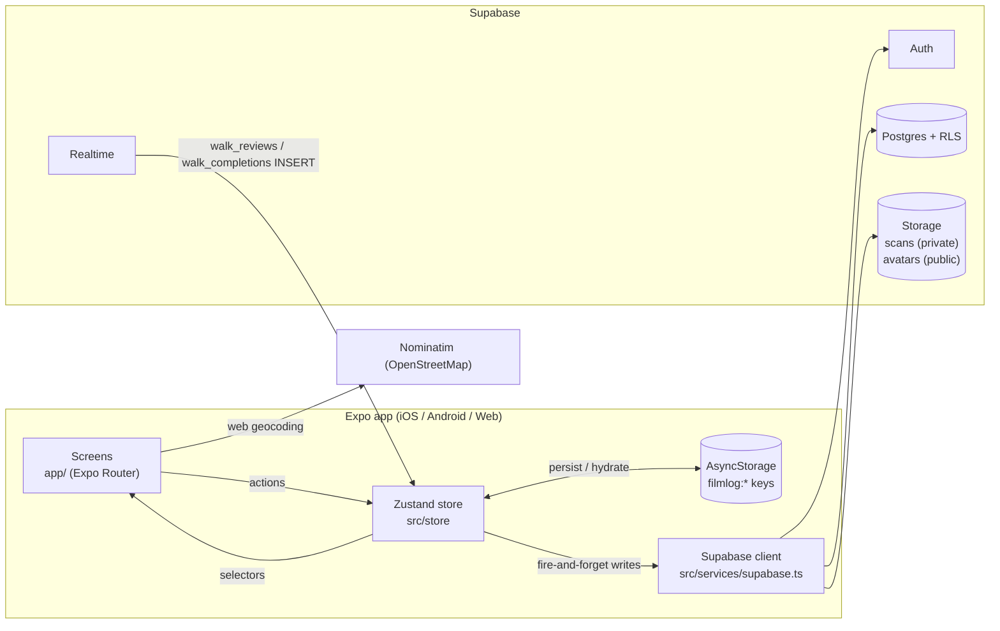

# Architecture

This document explains how Film Log is put together: the runtime layers, how data moves between the device and Supabase, and the conventions that hold the codebase together. For setup instructions and the feature list, see [README.md](README.md).

---

## 1. High-level overview

Film Log is a single Expo (React Native) codebase that ships to **iOS, Android, and the web**. It is **offline-first**: every write lands in a local Zustand store and is persisted to AsyncStorage immediately; Supabase is a background sync target, not the source of truth for the UI.



| Layer | Location | Responsibility |
|---|---|---|
| Routing & screens | `app/` | File-based routes (Expo Router). Screens read from and dispatch to the store; a few read-only public queries (profiles, community data) call Supabase directly. |
| State | `src/store/index.ts` | Single Zustand store: domain data, auth user, notifications, persistence, and sync with Supabase. |
| Backend access | `src/services/supabase.ts` | Supabase client setup plus auth and storage helpers (sign in/up, password reset, scan/avatar upload, signed URLs). |
| Domain model | `src/types/index.ts` | All TypeScript interfaces (`Roll`, `Shot`, `Walk`, `UserProfile`, …). |
| Static config | `src/constants/index.ts` | Theme (`COLORS`, `FONTS`), default gear, option lists, and the `BADGES` definitions. |
| Pure logic | `src/utils/` | IDs, dates, validation (`index.ts`), and badge/stat computation (`badges.ts`). |
| UI components | `src/components/` | Shared components (currently `BadgeToast`). |
| Web shims | `src/mocks/` + `metro.config.js` | Native-only modules swapped for no-op stubs on web. |
| Database | `supabase/*.sql` | Incremental SQL scripts run manually in the Supabase SQL editor. |

---

## 2. Directory layout

```
filmlog/
├── app/                        # Expo Router — every file is a route
│   ├── _layout.tsx             # Root stack, session bootstrap, auth gate, Realtime subscription
│   ├── (tabs)/                 # Bottom tabs: Rolls (search + filters), Film Stash (inventory), Develop (chemical sets, batches, calculator), Journal (list + map toggle), Settings; Walks is hidden in v1 (SOCIAL_ENABLED)
│   ├── auth/                   # login, signup, reset-password
│   ├── roll/                   # [id] detail, new, import (native) / import.web (web)
│   ├── calculator.tsx          # Development calculator
│   ├── batch/new.tsx           # Develop a batch of rolls
│   ├── journal/[label].tsx     # Per-location journal + frame timeline
│   ├── walks/                  # [id] detail, new (create/edit)
│   ├── profile/[userId].tsx    # Public profile view
│   └── settings/               # gear, profile, stats
├── src/
│   ├── components/             # Shared UI (BadgeToast, Dropdown, LabDropoffModal, ShotMap)
│   ├── constants/              # Theme, defaults, badge definitions
│   ├── mocks/                  # *.web.js stubs for native-only packages
│   ├── services/supabase.ts    # Supabase client + auth/storage helpers
│   ├── store/index.ts          # Zustand store
│   ├── types/index.ts          # Domain types
│   └── utils/                  # Pure helpers and badge engine
├── supabase/                   # SQL scripts, run in numeric order (see §6)
├── metro.config.js             # Web module stubbing
├── app.json                    # Expo config (permissions, scheme, bundle IDs)
└── .env.example                # Required environment variables
```

The `@/*` path alias maps to `src/*` (see `tsconfig.json`).

---

## 3. Application lifecycle

`app/_layout.tsx` owns startup and auth:

1. **Hydrate:** `hydrate()` loads every `filmlog:*` key from AsyncStorage into the store, so the UI is usable before any network call.
2. **Restore session:** `supabase.auth.getSession()` is checked once.
3. **Cross-account guard:** the last signed-in user ID is stored under `filmlog:userId`. Signing in as a different account clears this device's data first, but only once every roll/frame change made here has synced (`isAccountSwitchBlocked` in `src/utils/accountSyncSafety.ts`); otherwise the sign-in is refused. A device that has never signed in keeps its rolls and syncs them to the first account.
4. **Sync:** for the same user, `uploadLocalToSupabase()` pushes non-roll data up, then `syncFromSupabase()` pulls it down and starts `runRollSync()` for rolls and frames (see §4).
5. **Profile & Realtime:** `loadMyProfile()` runs, and `subscribeToCreatorNotifications()` opens Realtime channels while a user is signed in.
6. **Auth gate:** after init, unauthenticated users are redirected to `/auth/login`, and authenticated users are redirected away from `/auth/*`.

`onAuthStateChange` handles mid-session sign-ins and sign-outs using the same logic. It skips the initial event that `init()` already handled, so the app doesn't sync twice.

**Sign-out** (`clearUserData`) clears the active user, profile and custom gear but keeps rolls and their sync state, so the same user gets them back immediately on re-login.

---

## 4. State & sync model

### Write path

Every mutating store action follows the same pattern:

```
set(newState)            → UI re-renders immediately
get().persist()          → whole store snapshot written to AsyncStorage
computeBadgeNotifications → diff badge stats before/after, queue toasts
if (user) supabase.…     → background insert/upsert/delete, errors logged only
```

Remote writes for non-roll entities are **fire-and-forget** upserts. Rolls and frames instead call `scheduleRollSync()`, which runs the conflict-safe sync below.

### Roll & frame sync

Pure logic is in `src/utils/rollMerge.ts`, network calls in `src/services/rollSyncApi.ts`, and orchestration in the store's `runRollSync()`.

- **Base per record.** `rollSyncMeta` stores, for every roll and frame this device has synced, the server `sync_revision` and field values it last agreed with the cloud. It's persisted under `filmlog:rollSyncMeta` with the owning user ID. There's no outbox: unsynced work is derived by comparing current data with the base, so it survives restarts and can't drift.
- **Pull (atomic).** Fetch all of the user's rolls, shots (paginated past the 1,000-row cap) and tombstones, then `reconcile()` synchronously and commit, so no local edit can land mid-merge. For each record: cloud unchanged since the base → keep local; otherwise a three-way merge per field. Only a field changed differently on both sides is a conflict. `updated_at` takes the newest value and `created_at` the earliest. With no base (records that existed before this sync), an empty value on one side fills from the other.
- **Push.** `pendingOps()` lists creates and updates (rolls before frames), then deletes (frames before rolls). Each one calls a guarded RPC with the base revision. On `saved` the base moves to exactly what was sent. On `conflict` the loop pulls again and re-merges, up to four rounds.
- **Deletes.** Deleted here and unchanged in the cloud → guarded delete (tombstone). Deleted here but changed elsewhere → restored, with a notice. Deleted elsewhere and unchanged here → removed here. Deleted elsewhere but changed here → a conflict ("keep my copy" re-creates it under new IDs, because the old ID stays reserved by its tombstone).
- **Conflicts** block only the affected record. They appear in Settings → Sync (`SyncPanel`), where you pick per field. The choice becomes a normal local edit on top of the cloud version.
- **Scan files** are never deleted directly. When a guarded frame write that removes or replaces `scan_uri` succeeds (or a frame is deleted), sync removes the old file.
- **Triggers.** Local mutations (debounced 1.5 s), Realtime changes on `rolls`/`shots` (18), a 60 s interval and returning to the foreground. Runs are single-flight; a change during a run queues another.

### Read / merge path (`syncFromSupabase`)

| Entity | Merge rule |
|---|---|
| Rolls | Three-way merge per field against the last-synced base; same-field edits on both sides become conflicts for the user (see Roll & frame sync). |
| Cameras / film stocks | `DEFAULT_*` constants plus the user's custom rows from Supabase. |
| Journals | Remote journals win, matched by **case-insensitive `locationLabel`**. Local-only labels are kept. |
| Personal walks | Remote walks win, matched by ID. Local-only walks are kept. |
| Completions / my reviews | Replaced by the remote set when the query succeeds. |
| Community walks, walk reviews | Memory-only. Fetched on demand and never persisted. |

Apart from rolls and frames, there's no conflict resolution: remote rows overwrite local rows with the same ID.

### IDs & mapping

- IDs are generated on the client (`uid()` in `src/utils`) and used as `text` primary keys, which makes offline creation and idempotent upserts possible.
- The store has explicit mappers (`rollToDb` / `dbToRoll`, …) that convert between camelCase TypeScript objects and snake_case columns.
- Array fields (`Shot.tags`, `Walk.tags`) are stored as **JSON strings** in `text` columns and parsed with a try/catch guard.

### Visibility

- **Walks** are stored locally for everyone, but are written to Supabase on create only when `isPublic` is true. Edits to an existing walk always upsert.
- **Rolls** have an `is_public` flag. Public rolls and their shots can be read by any authenticated user (`supabase/04_roll_visibility.sql`).
- **Profiles** are readable by other users only when `is_public` is true; you can always read your own (`supabase/06_security_hardening.sql`).

---

## 5. Feature subsystems

### Scans (media)
- Scans are uploaded to the private `scans` bucket at `{userId}/{rollId}/{shotId}.{ext}`. The storage path is saved in `shots.scan_uri`.
- Scans are displayed through **signed URLs with a 1-hour expiry** (`getScanUrl`).
- Bulk import takes images or ZIPs. On a phone (`roll/import.tsx`) the user picks **Photos** (`expo-image-picker`, tap order kept) or **Files** (`expo-document-picker`, sorted by name), both at full quality (`src/utils/pickScans.ts`). ZIPs are unpacked with `fflate`: synchronously on native, which has no Web Workers, and asynchronously in the browser (`roll/import.web.tsx`). Filenames are auto-matched to frame numbers, and the user can reassign them before upload.
- Upload safeguards (`src/utils/scanUploadSafety.ts`): each file's first bytes must match a JPEG, PNG, TIFF or HEIC signature, which also sets the content type; scans over 50 MB and ZIPs over 500 MB are refused; each upload has a size-scaled timeout and one automatic retry on network errors; storage errors become readable messages, and failed files can be retried. Handled failures aren't logged as console errors.
- Avatars go to the **public** `avatars` bucket at `{userId}/avatar.{ext}` and are served with public URLs.

### Location
- GPS is captured with `expo-location` when a frame is logged, if permission has been granted.
- Turning typed text into coordinates (geocoding) uses `Location.geocodeAsync` on native and the public **Nominatim** API on web (`app/roll/[id].tsx`).
- Every distinct `locationLabel` becomes a **Location Journal**, keyed by label (case-insensitive).

### Inventory, lab drop-offs and backup
- Purchases (`film_purchases`) feed the Film Stash tab; loading a roll from inventory increments `quantityLoaded`.
- Statuses: Shooting → To Develop → In Development / In Lab → In Scanning → Archived. Old values are mapped through `normalizeStatus`.
- A lab drop-off (`lab_dropoffs`) groups rolls; each roll records whether the lab develops and/or scans it.
- After import, the app verifies each scan can be fetched back and stamps `rolls.backed_up_at` / `backed_up_count`.

### Development calculator, chemical sets and batches
- `src/utils/devCalc.ts` is pure: B&W lookups by film/developer/dilution, push/pull curves, temperature compensation, and fixed-temperature C-41/E-6/ECN-2 kits. Reference data is bundled (`src/constants/devData*.ts`), not stored in Supabase.
- The Develop tab lists chemical sets, recent batches and links to the calculator. `src/utils/filmMatch.ts` maps the app's film stocks onto the calculator's reference data; `src/utils/batchPlan.ts` computes each picked roll's time and blocks bad combinations (different processes, remjet mixed with non-remjet, times more than 5% apart, no recipe for the film).
- Chemical sets (`chemical_sets`) track shelf life and capacity (`src/utils/chemistry.ts`). A batch (`dev_batches`) stores its roll IDs, the time and temperature used, and on finish writes development fields onto each roll and moves them to In Scanning.

### Search, stats and export
- `src/utils/rollFilter.ts` powers the Rolls-tab search and filters; `src/utils/summary.ts` powers the stats card (this month / all time).
- `src/utils/exportXlsx.ts` builds one .xlsx (Rolls, All frames, a sheet per roll, linked) by writing the XML and zipping it with fflate; `exportFiles.ts` downloads it on web or opens the share sheet on native.

### Badges & notifications
- Badges are **computed entirely on the client** from store data (`src/utils/badges.ts` + `BADGES` in constants). There is no database table for them.
- Each relevant action compares stats before and after, then queues `AppNotification`s that `BadgeToast` renders.
- "Progress nudge" keys that have already been shown are persisted (`filmlog:shownNudges`) so a nudge never repeats.

### Walks & creator notifications
- Walks have ordered stops (`walk_stops.order_index`), completions, and reviews (one per user per walk).
- Denormalized counters (`completion_count`, `avg_rating`) are maintained by database triggers on `walk_completions` and `walk_reviews` (`supabase/06_security_hardening.sql`). The client never writes them.
- When someone else reviews or completes a walk, its creator gets a toast via **Supabase Realtime**:
  - `walk_reviews` INSERT is the primary trigger, because it carries the rating and review text.
  - A `walk_completions` INSERT triggers only if no review event arrives within 4 seconds for the same walk and user.

---

## 6. Database

Tables live in the `public` schema and RLS is enabled on all of them. Each row is owned through `user_id` (or `created_by_user_id` for walks).

| Table | Purpose |
|---|---|
| `rolls`, `shots` | Core film log data. `shots.roll_id` → `rolls.id`. |
| `cameras`, `film_stocks` | User-defined gear. Defaults are not stored. |
| `location_journals` | Notes per location label. |
| `walks`, `walk_stops`, `walk_completions`, `walk_reviews` | Photo walks. |
| `profiles` | Public handle, display name, bio, avatar. |
| `film_purchases` | Film inventory. |
| `lab_dropoffs` | Lab drop-offs; rolls link via `lab_dropoff_id`. |
| `chemical_sets`, `dev_batches` | Chemistry tracking and development batches. |

**Setup order:**

1. The base tables in the README's *Supabase Setup* section (`rolls`, `shots`, `cameras`, `film_stocks`, `location_journals`) plus their RLS policies and the `scans` bucket.
2. `supabase/01_walks.sql`: walk tables, RLS, Realtime on completions, and counter RPCs.
3. `supabase/02_realtime_creator_notifications.sql`
4. `supabase/03_walk_edit_policies.sql`
5. `supabase/04_roll_visibility.sql`
6. `supabase/05_profiles_avatars.sql`
7. `06_security_hardening.sql` through `10_chemical_sets_batches.sql` (hardening, inventory, lab drop-offs, scan backup, chemical sets and batches)

These are hand-run scripts, not a migration tool. Most are written to be re-runnable (`IF NOT EXISTS`, `DROP POLICY IF EXISTS`). The exception is `01_walks.sql`: its `CREATE POLICY` statements fail if the policies already exist.

---

## 7. Cross-platform strategy

- **Platform files:** Expo Router resolves `*.web.tsx` ahead of `*.tsx` on web (e.g. `roll/import.web.tsx`).
- **Module stubs:** `metro.config.js` redirects `react-native-maps` to `src/mocks/react-native-maps.web.js` on web.
- **Dialogs:** `Alert.alert` is a no-op on web, so screens use an inline "confirm" state instead.
- **Auth on web:** `detectSessionInUrl` is enabled only on web, so password-reset links can be parsed from the URL. The reset screen listens to both `getSession()` and `onAuthStateChange` because Supabase may consume the token before React mounts.

---

## 8. Security model & known limitations

**Secrets.** The client uses only the Supabase **publishable (anon) key**, loaded from `.env` via `EXPO_PUBLIC_*` variables. Anything prefixed `EXPO_PUBLIC_` is bundled into the app and visible to users, so **RLS is the real security boundary**. Never put a `service_role` / secret key in this app.

**Known limitations / tech debt** (contributions welcome):

- **Security hardening lives in `supabase/06_security_hardening.sql`.** It keeps private profiles unreadable by others, drops the README's overlapping walk policies, replaces the counter RPCs with triggers, and ignores client writes to `completion_count`, `avg_rating` and `is_featured`. Run it on every project; a database built only from the README's SQL still has the old gaps.
- **Conflict resolution covers rolls and frames only.** Other entities still use last-write-wins upserts and can overwrite each other's changes.
- **Whole-store persistence.** Every action rewrites every AsyncStorage key, which is fine at current data sizes.
- **Large screen files.** `app/roll/[id].tsx` is about 2,300 lines and a candidate for splitting into components.
- **Tests:** Jest unit tests cover `src/utils/` (`npm test`), and `supabase/tests/` holds SQL tests for the guarded write and delete functions. Screens aren't tested, and status-transition validation has no tests yet.
- **Uploads stall if the phone locks mid-import**, and large TIFFs upload in one request with no byte-level progress; resumable uploads are a follow-up.

---

## 9. Conventions

- Add or modify domain types in `src/types/index.ts` first, then update the store mappers.
- Store actions: update local state → `persist()` → background Supabase write.
- Frame-count reductions must go through `validateFrameCountChange()`. Only the last logged frame can be deleted, because film can't be un-exposed.
- Scan attachment is allowed only once a roll is `At Lab`, `Developed`, or `Archived`.
- New Supabase schema changes go in a new numbered file in `supabase/`, written to be re-runnable.
